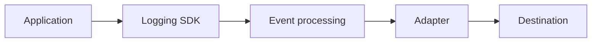

# Architecture

An application calls `Logger`. The logger builds one dictionary, filters it, and hands it to `SyncDelivery`. The delivery object calls the adapter. The adapter writes to a console stream or a file.

## Modules

| Module | Responsibility |
| --- | --- |
| `config.py` | `LoggingConfig` and environment loading |
| `logger.py` | Public methods, lifecycle, destination-error policy |
| `event.py` | Event schema, timestamps, JSON-safe values |
| `filters.py` | Minimum level check |
| `redaction.py` | Structured key redaction |
| `context.py` | Metadata merge and correlation id |
| `registry.py` | Destination name to adapter class |
| `factory.py` | Adapter construction and `SyncDelivery` |
| `adapters/` | Console, file, and shared file |

The logger does not contain file paths, HTTP calls, or a chain of destination conditionals. It asks the registry for the class named by `destination`.

## Synchronous delivery

`SyncDelivery.deliver` calls `adapter.write` on the calling thread and returns when that call returns. `flush` and `close` are also synchronous.

There is no worker thread, in-memory queue, batch, or retry loop. A future class can implement `deliver`, `flush`, and `close` and be passed into the logger the same way `SyncDelivery` is. Logging calls in application code do not need new method names for that change. This release always constructs `SyncDelivery`.

## Lifecycle

`Logger.initialize` validates the config object, constructs the adapter, and calls `initialize` before returning. A second `initialize` creates a second logger. The library does not attach handlers to the standard-library root logger, so the two loggers do not register duplicate handlers.

`bind` copies context onto a new `Logger` that shares the destination runtime. `close` on any of them releases that destination.

## Failure isolation

Destination exceptions are handled in the logger, not by writing another event through the same adapter. Configuration problems fail before a logger is returned.
